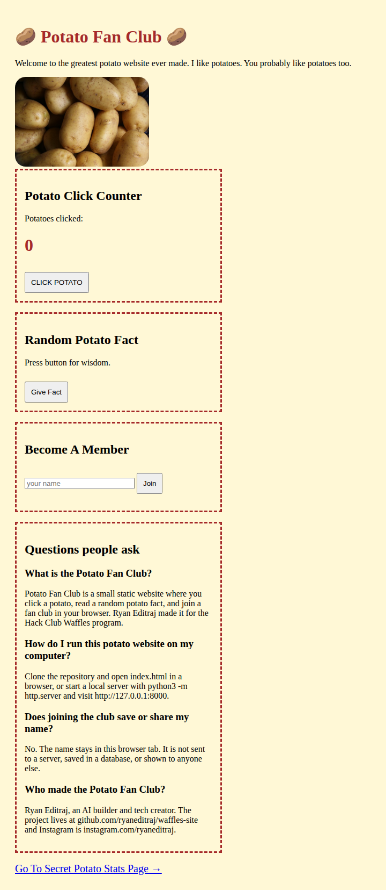
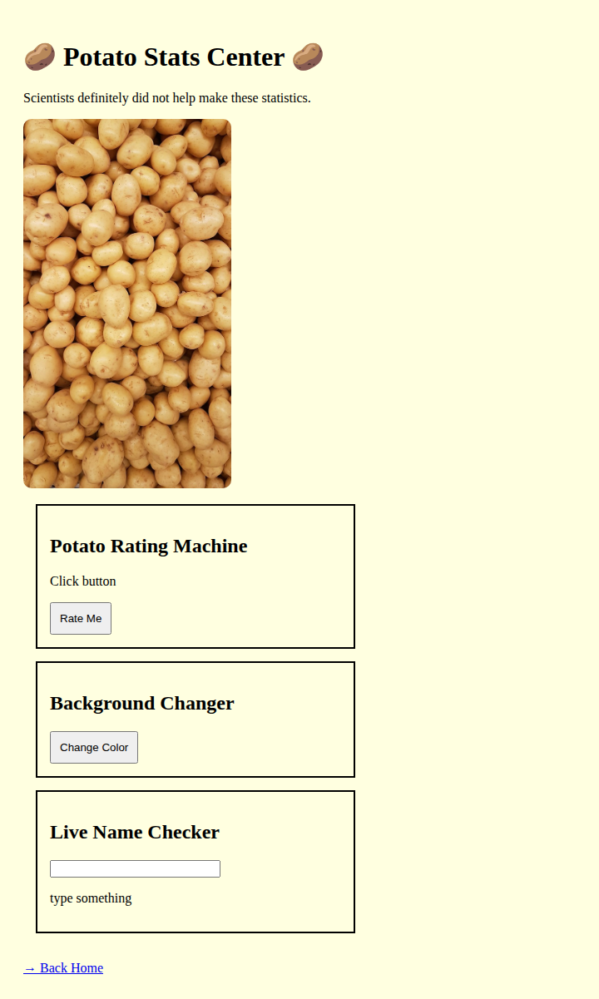
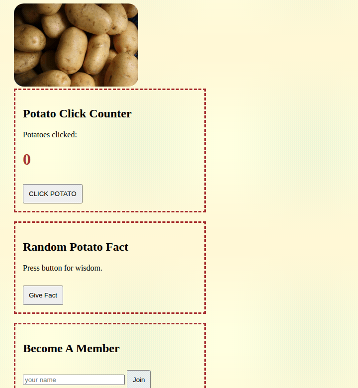

# Potato Fan Club

**Click a potato, collect a fact, and join the club. A tiny static website from the Hack Club Waffles program.**

Potato Fan Club is a browser-only potato clicker with random potato facts, a fan-club signup, and a not-very-scientific stats page. The repository is [`waffles-site`](https://github.com/ryaneditraj/waffles-site). It is HTML, CSS, and vanilla JavaScript: no build step, no backend, and no API key. [Ryan Editraj](https://github.com/ryaneditraj) made it, and it is open source under the MIT license.

[](LICENSE)
[](index.html)
[](https://github.com/ryaneditraj/waffles-site/actions/workflows/ci.yml)

## Demo

These pictures were captured from the site running in a local browser. They are screenshots of this repository, not mockups.





A short run through the clicker, a fact, joining the club, and the stats page:



## Features

- **Potato click counter.** Each click adds one. The count lives in the page until you reload.
- **Random potato facts.** Five short facts, including the important news that a potato never pays taxes.
- **Fan-club membership.** Type a name and the page welcomes that person. The name is shown as text and is not uploaded.
- **Potato Stats Center.** A random rating, a background color button, and a checker that calls short text short and longer text long.
- **Works offline from the files,** except for the two potato photos, which load from Unsplash.

## Tech stack

| Piece | Choice |
| --- | --- |
| Markup | HTML5 |
| Style | CSS, one stylesheet |
| Behavior | Vanilla JavaScript, no framework |
| Data | None. Nothing is stored or sent |
| Photos | Hotlinked from `images.unsplash.com` |
| Checks | Python script in GitHub Actions |
| Hosting fit | GitHub Pages from the repository root |

## Quick start

Install nothing. Any current browser can open the site. Python is only used to start a tiny local server, and it is already on macOS and most Linux systems.

```bash
git clone https://github.com/ryaneditraj/waffles-site.git
cd waffles-site
python3 -m http.server 8000
```

Open [http://127.0.0.1:8000](http://127.0.0.1:8000).

You can also open `index.html` directly from the folder. The local server matches the way GitHub Pages serves the files, so it is the better check.

### Publish on GitHub Pages

The meta tags, sitemap, and `robots.txt` use this address as the public site:

`https://ryaneditraj.github.io/waffles-site/`

To serve that URL, turn on Pages in the repository settings, choose **Deploy from a branch**, and set the branch to `main` and the folder to **`/ (root)`**. This pull request does not change those settings.

## Usage

1. Open the home page.
2. Press **CLICK POTATO**. The brown number goes up by one each time.
3. Press **Give Fact**. One of the five potato facts replaces “Press button for wisdom.”
4. Type a name and press **Join**. The line under the button reads `that name is now officially a potato fan.`
5. Follow **Go To Secret Potato Stats Page**.
6. Press **Rate Me** for a random rank from Tiny Potato through Supreme Potato Wizard.
7. Press **Change Color** to paint the page pink, light green, orange, light blue, or lavender.
8. Type in the name checker. Fewer than five characters says `that is a short thing`. Five or more says `wow long thing`.
9. Follow **Back Home**.

Reload the page to reset the counter, the fact, the membership line, the rating, and the background color.

## Project structure

```text
waffles-site/
├── index.html              Home: clicker, facts, membership, FAQ
├── stats.html              Potato Stats Center
├── assets/
│   ├── site.css            Shared styles for both pages
│   ├── home.js             Clicker, facts, and membership
│   ├── stats.js            Rating, color, and name length
│   └── favicon.svg
├── docs/screenshots/       Real browser captures used above
├── scripts/check_site.py   Local and CI checks
├── robots.txt
├── sitemap.xml
├── llms.txt                Short brief for answer engines
├── .env.example            Documents that no secrets are required
└── .github/                Issue templates, PR template, CI
```

## Roadmap

Ideas for later, not promises:

- [ ] Save a local copy of the potato photos so the pages work fully offline and stop calling Unsplash
- [ ] Remember the click count in `localStorage`
- [ ] Add more facts and ratings while keeping the jokes
- [ ] Let the fixed-width boxes sit more comfortably on a phone
- [ ] Note the live GitHub Pages URL here once Pages is switched on

## FAQ

### What is the Potato Fan Club?

Potato Fan Club is a small static website where you click a potato, read a random potato fact, and join a fan club in your browser. Ryan Editraj made it for the Hack Club Waffles program. The GitHub repository is named `waffles-site` because that was the program prompt. The pages themselves are about potatoes.

### How do I run this potato website on my computer?

Clone the repository and open `index.html` in a browser, or start a local server with `python3 -m http.server` and visit `http://127.0.0.1:8000`. There is no `npm install` and no build.

### Does joining the club save or share my name?

No. The name stays in this browser tab. It is not sent to a server, saved in a database, or shown to anyone else. A name that contains HTML is displayed as text.

### Who made the Potato Fan Club?

Ryan Editraj, an AI builder and tech creator. The project lives at [github.com/ryaneditraj/waffles-site](https://github.com/ryaneditraj/waffles-site) and Instagram is [instagram.com/ryaneditraj](https://instagram.com/ryaneditraj).

### Are the potato statistics real?

They are jokes. The stats page says so: scientists did not help. The rating is a random item from a list of five titles.

### What tech stack does the Potato Fan Club use?

HTML, CSS, and vanilla JavaScript. GitHub Actions runs `scripts/check_site.py`. The intended host is GitHub Pages. There is no framework and no package manifest.

### Does this site use cookies, accounts, or an API key?

It uses none of those. `.env.example` is in the repo so that stays obvious. The only third-party request is the browser loading two photos from `images.unsplash.com`.

### Is the Potato Fan Club open source, and how do I contribute?

Yes. It is MIT licensed. Read [CONTRIBUTING.md](CONTRIBUTING.md) for the local check and the rule about user-typed text. Community expectations are in [CODE_OF_CONDUCT.md](CODE_OF_CONDUCT.md).

## Contributing

Questions, facts, and bug reports are welcome. Keep the potato voice, keep user-typed names as text, and do not commit secrets. The short version of the workflow is: fork, branch, run `python3 scripts/check_site.py`, and open a pull request.

Details are in [CONTRIBUTING.md](CONTRIBUTING.md). Please follow the [Code of Conduct](CODE_OF_CONDUCT.md).

## Security

The membership box used to assign the typed name with `innerHTML`. It now uses `textContent`, and both pages send a Content-Security-Policy. No API keys were found in the tree or in git history, so there is nothing to rotate. The photos still come from Unsplash, and GitHub Pages cannot set HTTP security headers.

The full notes are in [SECURITY.md](SECURITY.md). Report a vulnerability through [GitHub security advisories](https://github.com/ryaneditraj/waffles-site/security/advisories/new).

## License

[MIT](LICENSE). Copyright (c) 2026 Ryan Editraj.

The two Unsplash photos stay under Unsplash’s license. They are not part of the MIT grant.

## Author

**Ryan Editraj** — AI builder and tech creator.

- GitHub: [github.com/ryaneditraj](https://github.com/ryaneditraj)
- Instagram: [instagram.com/ryaneditraj](https://instagram.com/ryaneditraj)
