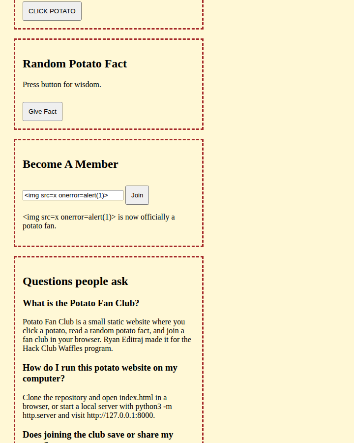

# Security policy

Potato Fan Club is a static website. It has no accounts, no server, and no database. The notes below are from a review of the two pages and the single commit that added them.

## Reporting a vulnerability

Please report privately through [GitHub security advisories](https://github.com/ryaneditraj/waffles-site/security/advisories/new).

Include the page, the steps, and what you expected. Please do not open a public issue for an unfixed vulnerability.

## Supported versions

| Version | Supported |
| --- | --- |
| `main` | Yes |

## What was reviewed

The repository history is one commit, `8a073db` (`Add files via upload`, 4 June 2026). The full diff of that commit and the current tree were read for secrets, injection, and unsafe configuration.

## Findings

### Fixed: membership name was written with `innerHTML`

`joinClub()` in `index.html` used to do this:

```javascript
document.getElementById("joinMsg").innerHTML =
    funnyName + " is now officially a potato fan.";
```

`funnyName` is whatever was typed into the box. A value such as `` would run as HTML in that browser tab. Nothing was stored or sent to another person, so this was self-XSS, not a cross-user bug. It was still the wrong pattern to ship.

The name, the click count, the facts, the rating, and the length-checker messages now use `textContent`. Inline event handlers were removed so the pages can ship a Content-Security-Policy without `'unsafe-inline'`. Styles and scripts live in `assets/`.

This is the membership box after joining with that payload. The page shows the characters. It does not load an image and it does not run the handler.



The policy is a `<meta>` tag:

```text
default-src 'self';
img-src 'self' https://images.unsplash.com;
style-src 'self';
script-src 'self' plus a hash of the JSON-LD block;
base-uri 'self'; form-action 'self'; object-src 'none'
```

`scripts/check_site.py` rejects `innerHTML` and checks that each JSON-LD hash is the one in that page’s policy.

### No secrets were found. Nothing to rotate.

There is no API key, token, password, private key, or `.env` value in the current files or in git history. `.env.example` only records that the site needs no configuration. `.gitignore` ignores `.env` so a future secret is less likely to be committed.

History was not rewritten.

### No dependency vulnerabilities to patch

There is no `package.json`, lockfile, or vendored library. GitHub Actions uses `actions/checkout` pinned to a commit. Dependabot watches that workflow.

## Residual notes

The live site is [waffleshackclub.netlify.app](https://waffleshackclub.netlify.app). `_headers` sets `X-Content-Type-Options`, `Referrer-Policy`, `X-Frame-Options`, `Permissions-Policy`, and `frame-ancestors` on that host. The meta Content-Security-Policy still covers scripts, styles, and images.

| Topic | Why it remains |
| --- | --- |
| Unsplash photos | Both pages still request `images.unsplash.com`. A visitor’s browser contacts Unsplash to load the pictures. The images use `referrerpolicy="no-referrer"`. The Content-Security-Policy allows that host and no other image host. |
| Netlify deploy-preview toolbar | Preview HTML includes `/.netlify/scripts/cdp` and an inline `style` attribute, and that script tries to frame `https://app.netlify.com/`. The meta policy blocks the inline style and that frame. Potato buttons still run. Production HTML checked on 23 October 2026 does not include that script. |
| Joke stats and client-only membership | Ratings are random strings. Names disappear on reload. Do not describe the site as an account system. |
| Content-Security-Policy split | Script and style rules are in the meta tag, where a hash can match each page’s JSON-LD. `frame-ancestors` is in `_headers` because a meta tag cannot set it. |
| Self-hosted photos | Until the photos live in the repo, the page is not fully offline and depends on Unsplash staying up. |

## Hardening already in the pages

- `charset` and `viewport` are set.
- External CSS and JavaScript, so style and script sources are `'self'`.
- JSON-LD is allowed by hash, not by `'unsafe-inline'`.
- `object-src 'none'` and `base-uri 'self'`.
- Images declare `alt` text and `referrerpolicy="no-referrer"`.
- Membership and checker output nodes use `aria-live="polite"`.
